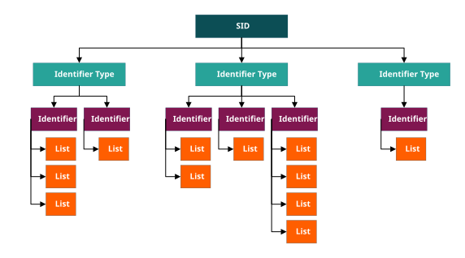
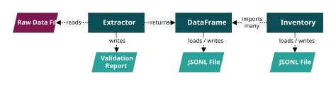

# The Global Inventory Compiler (GIC)
A Python library for integrating regulatory chemical lists into a unified global inventory for analysis, comparison, screening and prioritisation.

## Installation
Clone this repository and install with [uv](https://docs.astral.sh/uv/):

	git clone https://github.com/envris/global-inventory-compiler.git
	cd global-inventory-compiler/
	uv sync --locked

This installs the package and its runtime dependencies into a project-local `.venv`. The CLI commands (`gic-build`, `gic-stats`, `gic-gremlins`) can be run with `uv run gic-build ...`, or you can activate the environment with `source .venv/bin/activate` (`.venv\Scripts\activate` on Windows) and call them directly. The shell examples below assume the environment is activated.

## Introduction
### What is a global inventory?
A global inventory is a consolidated compilation of multiple regulatory chemical lists. These lists indicate whether a substance is registered for use or subject to regulatory controls such as monitoring, restriction, or prohibition.

### Why is a global inventory useful?
Combining regulatory inventories from around the world into a single dataset provides a broad view of substances that may enter the environment in significant quantities or appear in consumer products. A global inventory helps users understand how these substances are managed under domestic and international regulatory frameworks.

### What makes a global inventory difficult to compile and maintain?
Regulatory lists are updated continuously and published in a wide range of formats across different databases. They also often identify the same substance using different identifiers, naming conventions, or synonyms. These inconsistencies make it difficult to integrate lists, keep them current, and reliably determine whether a substance is subject to regulation.

### What is the GIC?
The GIC is a Python library built around two core classes: **Inventory** and **DataFrame**. The Inventory class organises chemical identifiers into substance entities indexed by an arbitrarily assigned substance identifier (SID), records their associations with source regulatory lists, and supports queries to identify substances that are unique to individual lists or shared across multiple lists. The DataFrame class provides a standardised and validated intermediate structure for extracted regulatory data before it is compiled into an Inventory.

### What are substances and SIDs?
Substances are the core entities of the GIC and represent unique, expandable groupings of synonymous name‑based (e.g. IUPAC names, common names) and key‑based identifiers (e.g. InChIKeys, European Community numbers). Substances are indexed using SIDs and dynamically created, expanded, and merged as the global inventory is compiled, based on identifier–identifier associations encountered across source lists.

Key benefits of this approach include:

* **Unified indexing:** SIDs provide a common, high‑level primary key that unifies information from multiple sources and enables reliable comparison of differences and overlaps between regulatory lists.
* **Reduced manual curation:** Any number of identifiers, of any identifier type, can be automatically reconciled into a substance through a simple, rules‑based process. This removes the need to manually designate a representative subset of identifiers from a pool of equally viable alternatives.
* **Full traceability:** All identifiers retain links to their original source lists, allowing query results to be easily verified.
* **Quality assurance:** Each identifier is cleaned and validated according to its type (e.g. checksum validation for European Community numbers).



*NOTE: GIC SIDs are internal processing variables used primarily for indexation and queries. They have no meaning outside a specific global inventory, and their assignments will almost always vary between global inventories. They should never be used as substance identifiers for communication, reference, or reporting purposes.*

### How does the GIC help?
DataFrame objects act as modular building blocks that can be prepared and maintained independently, then periodically recompiled into an up-to-date global inventory. Organising the Inventory into substance entities also improves the robustness of cross-list comparison by removing the need for different lists to use the same identifiers in order to register a match. Both Inventory and DataFrame objects can be saved to and loaded from JSONL files, supporting portability and long-term storage of the compiled inventory and its component datasets. Extractors are also provided to help extract data from delimited text files, XLSX and PDF files into validated DataFrames.



## Quickstart guide to compiling a global inventory
Inventory compilation is performed using a series of command‑line scripts executed in a terminal environment such as Bash or PowerShell. These steps assume that the relevant regulatory lists have already been extracted into DataFrame objects and saved as JSONL files inside a single directory.

### Step 1: Identify gremlin chemical names
Gremlins are non‑specific names, placeholders (for example, “no name provided”), or broad group names (for example, “nickel and compounds”) that may refer to multiple substances. If they are not identified and excluded, the compiler may incorrectly merge distinct substances under a single SID.

```shell
gic-gremlins \
	-j jsonl\
	-g gremlins_potential.csv \
	--gremlins_cutoff 5

cp gremlins_potential.csv gremlins_actual.csv
```

All JSONL files within the *jsonl* directory and its subdirectories are scanned for chemical names that occur five or more times within a single file. These candidates are written to *gremlins_potential.csv* for manual review. Create *gremlins_actual.csv* from that file and remove any entries that correspond to legitimate substance names. After this curation step, only the confirmed gremlin names should remain.

### Step 2: Compile the global inventory
```shell
gic-build \
	-j jsonl \
	-g gremlins_actual.csv \
	-o ec_number,chemical_name \
	-i inventory.jsonl
```

All files with a *.jsonl* extension in the *jsonl* directory and its subdirectories will be used to compile the inventory. Chemical names listed in *gremlins_actual.csv* will be excluded during compilation. The resulting inventory will be ordered in ascending sequence by European Community (EC) number and then by chemical name saved to *inventory.jsonl*.

### Step 3: Calculate post-compilation statistics
```shell
gic-stats \
	-i inventory.jsonl \
	-s stats.csv
```

A suite of quality-control statistics will be calculated from *inventory.jsonl* and saved to *stats.csv*. These statistics include counts of unique identifiers, identifier-to-substance relationships, and the number of substances that are unique to a particular *list_tag* or shared across multiple *list_tag* values.


## Example usage of the library
The GIC provides Python classes and functions for data extraction, global inventory querying, and analysis of consolidated regulatory datasets. The Jupyter Notebooks below illustrate common usage patterns.

### Extracting raw data into Data Frames and JSONL files
All source data must first be standardised into a GIC Data Frame before it can be analysed or used to construct a global inventory. Data Frames can be saved to and loaded from JSONL. The following examples demonstrate how to extract data from various sources and store it for later use.

* [Australian Inventory of Industrial Chemicals.](examples/aiic_extraction.ipynb)
* [EU REACH Substances of Very High Concern (SVHC) list.](examples/reach_svhc_extraction.ipynb)
* [US Toxic Substances Control Act inventory.](examples/tsca_extraction.ipynb)
* [PubChem SMILES and structure generation.](examples/pubchem_smiles_extraction.ipynb)
* [EU CLP Annex VI and GHS codes.](examples/clp_ghs_extraction.ipynb)

### Querying a global inventory
A precompiled global inventory can be saved to and loaded from a JSONL file using the Inventory class. Once instantiated, an Inventory object can be queried to identify overlaps and unique entries across multiple regulatory lists. The following examples demonstrate typical query workflows.

* [Substances common across inventories.](examples/common_substances_analysis.ipynb)
* [Substances unique to just one inventory.](examples/unique_substances_analysis.ipynb)

### Contextualised analysis
The DataFrame is a generalised data structure capable of storing identifiers, contextual information (e.g. list tags), and standard data describing chemical properties such as structure (e.g. SMILES), hazard (e.g. GHS codes), and exposure (e.g. functional use, although such fields are not yet included).

In contrast, the Inventory is a more specialised structure that contains only identifier and contextual data. Its purpose is to organise this information in a way that enables reliable querying of substances (represented by SIDs) within their regulatory context.

The GIC provides mechanisms to integrate an Inventory with one or more DataFrames, allowing standard data to be queried within a defined regulatory context, which we refer to as "contextualised analysis".

* [Restricted substances similar to input structure.](examples/structural_similarity_analysis.ipynb)
* [Carcinogenic, mutagenic, or reprotoxic substances in plastic.](examples/cmr_plastics_analysis.ipynb)


## Additional notes
### Chemical Abstracts Service Registry Numbers®
This public release of the GIC does not include CAS RN®-specific fields or processing options. CAS RNs are also not included in [example datasets](data/). CAS RNs are proprietary identifiers owned by the Chemical Abstracts Service (CAS) and are subject to licensing restrictions.

### Development guide
See [docs/developers.md](docs/development.md) for detailed information on the development workflow, tooling, and project conventions.

### Contact
Please email contaminants@dcceew.gov.au for more information.